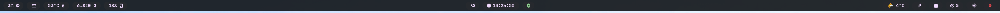
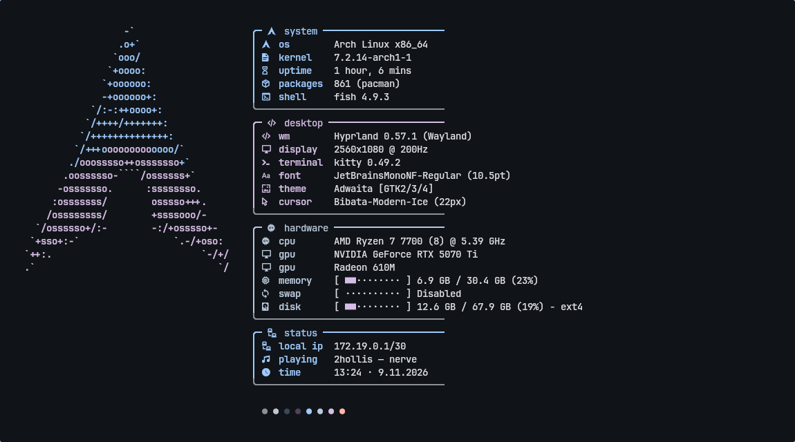
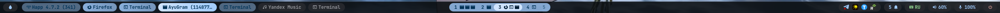
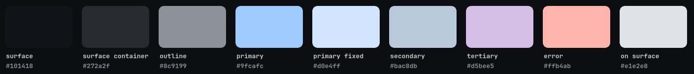
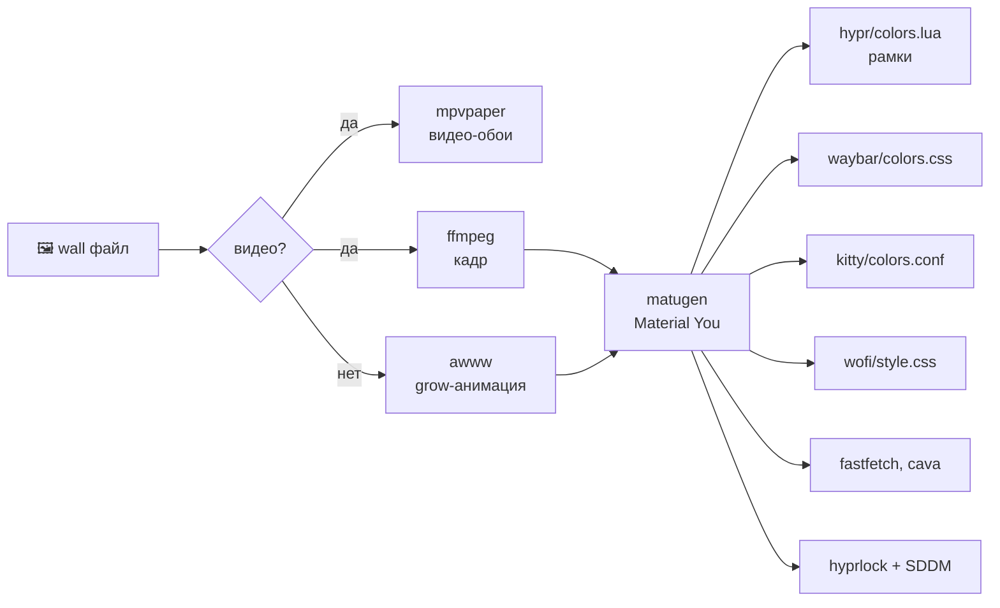

<div align="center">

# 󰣇 p1ckq · rice

**Hyprland на Arch Linux — стекло, живые обои и цвета, которые подстраиваются под картинку**






</div>

---

## ✦ Что внутри

| | |
|---|---|
| 🎨 **Автоцвета** | обои → `matugen` (Material You) → цвета рамок, баров, терминала, лаунчера, fastfetch, cava, экранов блокировки и входа |
| 🎬 **Живые обои** | видео через `mpvpaper`, 50 fps под 200 Гц, бесшовный цикл, замедление |
| 🌀 **Смена обоев** | анимация «круг от курсора» (`awww grow`) и перекраска всей системы одной клавишей |
| 📊 **Два бара** | сверху — система, часы, погода, кнопки; снизу — лаунчер, своя панель задач, рабочие столы с иконками окон |
| 🪟 **Своя панель задач** | клик сворачивает / разворачивает / переносит на нужный стол |
| ⏱ **Виджеты** | пиксельные часы, «дождь» из символов, эквалайзер `cava` — цвета из палитры |
| 🔭 **Обзор столов** | Hyprspace: миниатюры всех столов, перетаскивание окон между ними |
| 🪟 **Заголовки окон** | hyprbars настроен, но выключен (`HYPRBARS = true` в plugins.lua) |
| 🔔 **Центр уведомлений** | swaync: плеер с обложкой, Wi-Fi, Bluetooth, ночь, громкость |
| 🎵 **Сейчас играет** | трек в баре, ⏮ ⏯ ⏭ — работает с Яндекс Музыкой |
| 🌐 **Сеть** | меню Wi-Fi в лаунчере, индикаторы Wi-Fi и Bluetooth в баре |
| 🖌 **Единый стиль** | GTK (adw-gtk3), Qt и KDE-программы, Firefox (pywalfox) — в цветах обоев |
| 🔐 **Экраны** | `hyprlock` с большими часами и своя тема **SDDM** на QML |

---

## 🎨 Палитра



> Палитра генерируется заново при каждой смене обоев. Для отдельных обоев схему можно закрепить в `~/.config/rice/schemes.conf`.

---

## 🧱 Графический стек

### Композитор и протоколы
| Компонент | Версия | Роль |
|---|---|---|
| [Hyprland](https://hyprland.org) | 0.57.1 | тайлинговый Wayland-композитор, конфиг на **Lua** |
| [Aquamarine](https://github.com/hyprwm/aquamarine) | 0.16.0 | бэкенд рендеринга Hyprland (DRM/KMS, EGL, GBM) |
| hyprutils / hyprlang | 0.14.3 / 0.6.8 | библиотеки экосистемы Hyprland |
| Wayland + wlr-protocols | — | layer-shell (бары, обои), foreign-toplevel, screencopy |
| Mesa | 26.2.6 | OpenGL / EGL / Vulkan (Radeon 610M) |
| NVIDIA open | 615.78 | драйвер RTX 5070 Ti |

### Интерфейс
| Компонент | Версия | Тулкит | Роль |
|---|---|---|---|
| [Waybar](https://github.com/Alexays/Waybar) | 0.15.0 | **GTK 3** + gtk-layer-shell | оба бара |
| [wofi](https://hg.sr.ht/~scoopta/wofi) | 1.5.3 | **GTK 3** | лаунчер с сеткой |
| [SwayNC](https://github.com/ErikReider/SwayNotificationCenter) | 0.12.6 | **GTK 3/4** | уведомления |
| [hyprlock](https://github.com/hyprwm/hyprlock) | 0.9.7 | OpenGL (hyprgraphics) | экран блокировки |
| [SDDM](https://github.com/sddm/sddm) | 0.21.0 | **Qt 6 / QML** | экран входа, своя тема `rice` |
| [kitty](https://sw.kovidgoyal.net/kitty/) | 0.49.2 | **OpenGL** | терминал + виджеты |
| [hyprbars](https://github.com/hyprwm/hyprland-plugins) | hyprpm | Hyprland plugin API | заголовки окон |
| [Hyprspace](https://github.com/KZDKM/Hyprspace) | hyprpm | Hyprland plugin API | обзор рабочих столов |
| [adw-gtk3](https://github.com/lassekongo83/adw-gtk3) + Papirus | 6.5 | **GTK 3/4** | тема и иконки программ |
| qt6ct + Breeze | 0.11 | **Qt 6** | палитра Qt/KDE-программ |

### Обои и цвет
| Компонент | Версия | Роль |
|---|---|---|
| [mpvpaper](https://github.com/GhostNaN/mpvpaper) | 1.9 | видео-обои (**libmpv**, hwdec) |
| [mpv](https://mpv.io) | 0.41.0 | декодирование видео |
| [awww](https://github.com/LGFae/awww) | 0.12.1 | статичные обои + анимации переходов |
| [matugen](https://github.com/InioX/matugen) | 4.2.0 | Material You палитра из картинки → шаблоны |
| FFmpeg / ImageMagick | 9.0 / 7.1 | подготовка видео, кадры, превью |

### Терминал и звук
| Компонент | Версия | Роль |
|---|---|---|
| fish + [starship](https://starship.rs) | 4.9.3 / 1.27 | оболочка и промпт |
| [fastfetch](https://github.com/fastfetch-cli/fastfetch) | 2.70 | системная инфа, лого в цветах темы |
| [cava](https://github.com/karlstav/cava) | 1.0 | эквалайзер (**ncurses**) |
| PipeWire + WirePlumber | 1.6.10 / 0.5.18 | звук, `pipewire-pulse` для приложений |
| JetBrains Mono Nerd Font | 3.5.1 | шрифт и иконки везде |

### Утилиты
`grim` `slurp` `wf-recorder` `hyprpicker` `hyprsunset` `cliphist` `wl-clipboard` `hyprpolkitagent` `power-profiles-daemon`

---

## 🔁 Как работают цвета



---

## ⌨️ Горячие клавиши

| Клавиши | Действие |
|---|---|
| `Super + Q` / `Super + Enter` | терминал |
| `Super + R` / `Super + Space` | лаунчер wofi (там же Wi-Fi и Bluetooth) |
| `Super + Tab` | обзор всех столов |
| `Super + N` | центр уведомлений |
| `Super + C` | закрыть окно |
| `Super + H` | свернуть окно |
| `Super + Shift + H` | показать свёрнутые |
| `Super + F` | полный экран |
| `Super + V` | плавающее окно |
| `Super + 1…0` | перейти на стол |
| `Super + Shift + 1…0` | перенести окно на стол |
| `Super + ←↑→↓` | фокус |
| `Super + Alt + ←↑→↓` | поменять окна местами |
| `Super + Shift + ←↑→↓` | размер окна |
| `Super + W` / `Super + Shift + W` | следующие / случайные обои |
| `Super + D` | виджеты (часы, символы, cava) |
| `Super + L` | заблокировать |
| `Super + Shift + B` | перезапустить бар |
| `Print` / `Super + Shift + S` | скриншот области в буфер |
| `Super + Print` | скриншот экрана в буфер |
| `Super + S` / `Super + Ctrl + S` | скрытый стол / убрать на него окно |

**Панель задач:** ЛКМ — свернуть / развернуть / перейти к окну · ПКМ или СКМ — закрыть
**Заголовок окна:** голубая кнопка — свернуть, красная — закрыть
**Обзор (Super + Tab):** клик по столу — перейти · перетащить окно на стол — перенести · Esc — закрыть

---

## 📂 Структура

```
~/.config/
├── hypr/
│   ├── hyprland.lua        # главный конфиг (Lua)
│   ├── plugins.lua         # hyprbars + Hyprspace
│   └── hyprlock.conf
├── waybar/                 # два бара: config.jsonc + style.css
├── kitty/kitty.conf
├── wofi/config
├── rice/
│   ├── matugen.toml        # куда matugen пишет цвета
│   ├── templates/          # шаблоны: hypr, waybar, kitty, wofi, cava, fastfetch, hyprlock
│   ├── schemes.conf        # своя цветовая схема для конкретных обоев
│   └── wall-speed          # скорость видео-обоев
├── fastfetch/config.jsonc  # генерируется из шаблона
├── fish/config.fish
└── starship.toml
~/.local/bin/
├── wall                    # смена обоев + перекраска
├── rice-prep               # видео → 2560x1080@50fps, бесшовный цикл
├── rice-task               # своя панель задач
├── rice-min                # сворачивание окон
├── rice-ws                 # рабочие столы с иконками окон
├── rice-widgets            # виджеты рабочего стола
├── rice-media, rice-bar    # «сейчас играет», сторож waybar
├── rice-wifi, rice-qs      # меню Wi-Fi, быстрые кнопки swaync
├── rice-clock, rice-rain   # пиксельные часы, «дождь» символов
└── rice-{power,weather,nightlight,record,clip}
~/.local/share/sddm-themes/rice/   # тема экрана входа (QML)
```

---

## 🛠 Установка

```bash
# 1. пакеты
sudo pacman -S --needed hyprland hyprlock hyprpicker hyprsunset hyprpolkitagent \
  waybar wofi swaync kitty fish starship fastfetch cava matugen awww mpv \
  pipewire-pulse pipewire-alsa wireplumber grim slurp wl-clipboard cliphist \
  wf-recorder power-profiles-daemon ttf-jetbrains-mono-nerd imagemagick ffmpeg sddm \
  hyprpm cmake adw-gtk-theme papirus-icon-theme qt6ct bluez bluez-utils blueman playerctl

# 2. плагины Hyprland
hyprpm update && hyprpm add https://github.com/hyprwm/hyprland-plugins && hyprpm enable hyprbars
hyprpm add https://github.com/KZDKM/Hyprspace && hyprpm enable Hyprspace

# 3. mpvpaper из AUR
git clone https://aur.archlinux.org/mpvpaper.git && cd mpvpaper && makepkg -si

# 4. конфиги
git clone --bare https://github.com/p1ckqq/dotfiles.git ~/.dotfiles
alias dots='git --git-dir=$HOME/.dotfiles --work-tree=$HOME'
dots checkout -f
dots config status.showUntrackedFiles no

# 5. тема экрана входа
sudo cp -r ~/.local/share/sddm-themes/rice /usr/share/sddm/themes/
printf '[Theme]\nCurrent=rice\n' | sudo tee /etc/sddm.conf.d/theme.conf

# 6. обои
mkdir -p ~/Pictures/wallpapers   # положить картинки или видео
rice-prep ~/Downloads/video.mp4 my-wall 0.3   # для видео
wall ~/Pictures/wallpapers/my-wall.mp4
```

> Монитор в конфиге: `2560x1080@200`. Для другого — поправь `hl.monitor(...)` в `hyprland.lua`.

---

## 🧰 Обслуживание

```bash
dots status                    # что поменялось
dots commit -am "что сделал"   # сохранить
dots push                      # на GitHub
dots checkout -- путь/к/файлу  # откатить файл

hyprctl configerrors           # проверить конфиг после обновления Hyprland
```

<div align="center">

<sub>собрано с 🩵 на Arch · Hyprland · matugen</sub>

</div>
